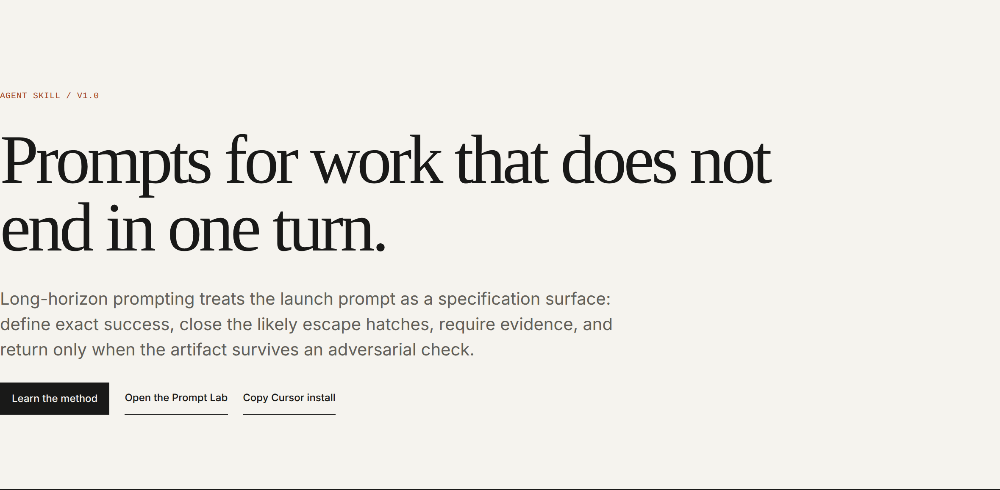

# 长时程提示词实验室网站

这是一个无需额外依赖的教学网站和提示词前后对照实验，用于演示 [`long-horizon-prompting`](../../skills/long-horizon-prompting/) 技能。网站介绍方法、提供可复制的任务简报模板和检查清单、整理研究证据及限制，并展示四组完整提示词改写。

本示例通过将技能应用于自身构建：每个“改写后”提示词都使用该技能的简报编写流程生成完整启动提示，并按 [`task-brief-template.md`](../../skills/long-horizon-prompting/references/task-brief-template.md) 中的评分规则评估。



## 网站内容

这是仓库中的长时程提示词项目站点。网页品牌为 Long-Horizon Prompting；GitHub Pages 使用以下仓库路径：

`https://muratcankoylan.github.io/Agent-Skills-for-Context-Engineering/`

- `index.html`：主题概览、简报结构、系统边界和站内导航。
- `guide.html`：八步方法、提示词与运行框架的分工、可复制模板、检查清单和易错点。
- `lab.html`：完整提示词对照、下载与复制功能、评分规则和剩余风险。
- `references.html`：研究、厂商指导、周期双重覆盖案例、证据标记和限制。

网页中的提示词会完整展开。截图工具只在捕获时添加专用页面样式，使发布截图尺寸稳定，不改变网站本身。

## 发布方式

1. 在仓库设置中打开 **Settings → Pages → Build and deployment**，将 Source 设为 GitHub Actions。
2. 合并到 `main`，或通过 `workflow_dispatch` 手动运行 **Deploy long-horizon prompt lab**。
3. 打开上方网站地址。

部署定义在 `.github/workflows/deploy-prompt-lab.yml`，只在 `main` 分支触发。

## 仓库内容

```text
report/            周期双重覆盖案例及来源记录
  cdc_prompt.pdf    OpenAI 发布的 GPT-5.6 Sol Ultra 提示词
  cdc_proof.pdf     候选证明，尚未审查；参见来源说明
  cdc_prompt.txt    提取文本，便于搜索和差异比较
  cdc_proof.txt
  PROVENANCE.md     来源网址、SHA-256、获取日期和限制
scripts/
  fetch_report.sh   重新获取 PDF 并提取文本
  verify_report.py  检查技能中的注释引用是否与公开提示词一致
  install_skill.sh  安装技能到 .cursor/skills 并进行结构检查
  build_lab.py      提示词对、评分规则和 UI 数据的规范来源
  validate_site.py  检查网页、元数据、链接、引用、站点地图和提示词
  capture.mjs       渲染网页并捕获发布截图
 data/prompt-pairs.json 机器可读的提示词对和分数
ui/                 静态多页网站和生成的提示词下载
screenshots/        可分享的生成 PNG
```

## 四组案例

每个“原始版本”都是实际经过提示词工程的启动提示，包含专家角色、任务上下文、推理和输出格式，并非故意设置的弱对照。每个“改写版本”都是可直接复制使用的完整提示词，而不是提纲或模板。

| 用例 | 领域 | 架构 | 简报预先阻止的失败 |
| --- | --- | --- | --- |
| 自主改进模型运行 | 机器学习训练 | 单智能体 | “超过指标”可能诱发训练集泄漏或单随机种子偶然获胜 |
| 并行近似比证明 | 算法与理论 | 64 个工作者编排 | 频繁同步和一致意见可能造成多样性坍塌 |
| 长时程分布式系统根因分析 | 并发系统 | 单智能体、多会话 | “找到根因”没有可检查的成功判定 |
| 自主安全审计/红队 | 应用安全 | 并行工作者 | 持续执行和清单可能放大未经核实的发现 |

不同案例主要改动不同：机器学习使用污染防护，证明任务使用多样性策略，根因分析使用可复现判定，安全审计明确哪些结果不算完成。这体现了该技能是一组独立失败模式检查，而不是单一技巧。

## 复现

```bash
# 从仓库根目录运行，需要 pypdf、Pillow 和可用的 Node/Chrome 环境
python3 -m pip install pypdf Pillow skills-ref

# 获取案例报告，并检查技能引用与原始提示词一致
examples/long-horizon-prompt-lab/scripts/fetch_report.sh
python3 examples/long-horizon-prompt-lab/scripts/verify_report.py

# 将技能安装到当前项目的 .cursor/skills 并检查
examples/long-horizon-prompt-lab/scripts/install_skill.sh

# 构建、检查或本地查看网站
cd examples/long-horizon-prompt-lab
npm ci
npm test
npm run serve
# 另开终端运行截图：npm run capture
```

本地地址为 `http://localhost:8000/`。实验室案例支持 `lab.html#security-audit` 之类的链接片段。网站可直接从文件查看；剪贴板功能和线上效果建议通过 HTTP 访问。

## 如何理解评分卡

每个维度按 0（缺失）、1（存在但容易规避）或 2（能抵御对抗）评分，直接依据技能中的评分规则。`n/a` 表示该维度不适用，例如单智能体任务不需要多样性策略；总分只计算适用维度。

## 诚实说明与限制

- 评分使用**该技能自己的评分规则**，因此“改写后”高分表示简报完整应用了该技能的检查清单。这是规格质量的结构性比较，不是任务成功率基准；它说明简报较难被近似结果糊弄，不保证任何运行一定成功。
- 每组案例都列出简报无法消除的剩余风险，例如预算需由运行框架强制执行、证明验证器可能宽松、问题表述可能不适定、提示词中的范围限制只是建议。网页会展示这些风险。
- `report/` 中的周期双重覆盖候选证明在发布时**没有同行评审或形式化验证**。本项目核验的是提示词结构，不是定理；详见 `report/PROVENANCE.md`。
- `.cursor/` 已加入 Git 忽略规则，因此安装后的技能副本不会提交；`scripts/install_skill.sh` 可重复完成安装。

## 展示的技能

核心技能为 `long-horizon-prompting`。案例中的职责划分还引用 `harness-engineering`（运行时强制的预算和权限）及 `multi-agent-patterns`（编排策略背后的拓扑设计）、`advanced-evaluation`（对抗性审查设计）。
